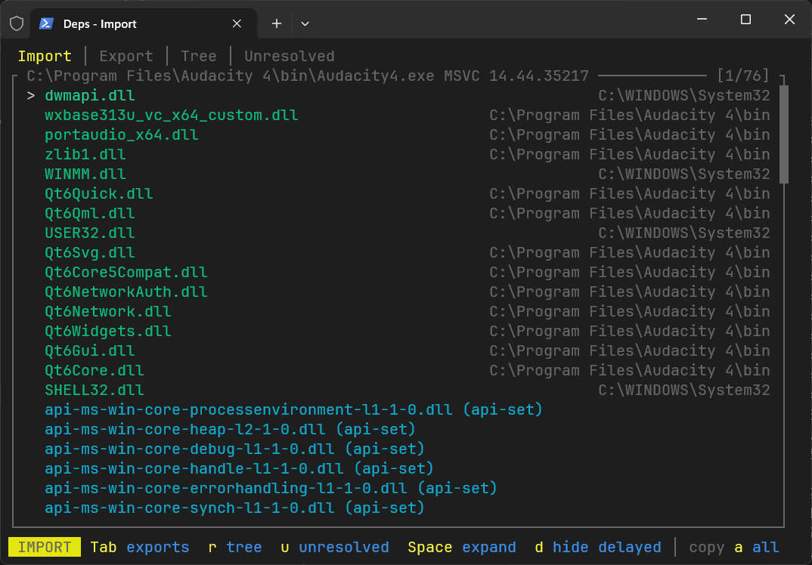

# deps

Explore Windows EXE and DLL dependencies from your terminal. **deps** is a lightweight dependency walker for PE files: see what an image imports, follow its dependency tree, and find unresolved modules with the names of their importers.

The interactive interface is built with [Catatui](https://github.com/Fiend3d/catatui). Prefer a report? Use the same tool from the command line.



## What you can do

- **Inspect imports and exports.** Expand imported functions, see imports by ordinal, and inspect export names, ordinals, and RVAs in the TUI.
- **Follow dependencies.** Browse resolved DLL paths, open a module, or explore a recursive tree without losing your place.
- **Find missing modules.** Get a recursive unresolved-dependency report with the modules that import each finding.
- **Separate delay-loaded imports.** Show them by default or hide them to focus your view.
- **Take results with you.** Copy names, paths, functions, trees, and reports, or print listings for scripts and redirected output.

## Quick start

Build from source on Windows with Git and **Go 1.27.3 or newer**, as required by `go.mod`:

```powershell
git clone https://github.com/Fiend3d/deps.git
cd deps
go build -o deps.exe .
.\deps.exe "C:\Windows\System32\notepad.exe"
```

Run `deps <filepath>` with no listing flags to open the TUI. If `deps.exe` is on your `PATH`, you can use `deps` from any directory.

For builds with version and commit information, use `.\build.ps1` instead of `go build`.

Also available through the `mc` integration: highlight a file and press **F2**.

## Command-line reports

```text
Usage: deps [flags] <filepath>
  -v    print version
  -i    print imports
  -e    print exports
  -r    print recursive dependencies
  -u    print only unresolved dependencies (recursive)
  -p    print without color
  -d    hide delay-loaded dependencies
```

```powershell
deps -i "C:\path\app.exe"
deps -e "C:\path\library.dll"
deps -r "C:\path\app.exe"
deps -u -d "C:\path\app.exe"
deps -r -p "C:\path\app.exe" > dependencies.txt
```

`-r` implies imports; `-e` can be combined with `-i` or `-r`. `-u` selects its own report and ignores `-i`, `-e`, and `-r`; `-p` and `-d` still apply. `-v` needs no file argument.

Printed output normally drops color when redirected. A nonempty `NO_COLOR` disables color; a nonempty `CLICOLOR_FORCE` other than `0` forces it, including when redirected. `NO_COLOR` takes precedence, and `-p` always disables color for reports.

## Missing dependencies and delay-loaded imports

`-u` walks the dependency graph and reports unresolved module names alongside their importers. For example, an illustrative report might look like this (actual results depend on the image and your machine):

```text
C:\path\app.exe MSVC 14.38.33145
optional.dll (delay)  <- plugin.dll
required.dll         <- app.exe

2 unresolved
```

The diagnostic exit status is **1** if any finding has a normal, non-delay import edge, and **0** if there are no findings or all findings are delay-only. A module imported both normally and with delay-loading counts as a normal-import finding. Failure to open or parse the input file also exits nonzero.

Delay-loaded imports bind when first used rather than at process start. `-d` hides them in import listings and dependency trees, including branches reachable only through those edges. With `-u`, it filters delay-only findings after the full scan, preserving normal-import findings and the diagnostic exit status.

In the TUI, press `u` for the same recursive report and `d` to toggle the delay-load filter. The header shows `-delay` while the filter is active. The tree resolves children as you expand them; the unresolved report scans the full graph on first use and caches the result while you stay on that file.

### How resolution works

deps searches the original image's directory, the architecture-appropriate Windows system directory (`SysWOW64` for x86 images, `System32` otherwise), the Windows directory, and then `PATH`.

API-set contracts are not counted as missing modules. They are resolved by the Windows loader through its schema; deps treats contracts without a matching file as virtual dependencies rather than following their host mappings. Matching API-set files are searched only in the image and Windows directories, not `PATH`.

A clean report means no missing modules were found by this scan. It does not guarantee startup: deps does not emulate every Windows loader rule, validate imported symbols, or include libraries loaded dynamically at runtime. Resolved dependencies that cannot be parsed are skipped by the unresolved scan.

## Keyboard and mouse

| Key | Action |
| --- | --- |
| `Up` / `Down`, `k` / `j` | Move selection |
| `Page Up` / `Page Down` | Move by half a page |
| `Home` / `End` | Jump to the first / last row |
| `Tab` | Switch between imports and exports while in either view |
| `r` | Toggle the recursive tree / imports |
| `u` | Toggle the unresolved report / imports |
| `Space` | Expand / collapse imported functions or a tree node |
| `Enter` | Open the selected module in imports or the tree |
| `l` / `Right` | Open a module in imports; expand / collapse a tree node |
| `h` / `Left` | Go back; in the tree, collapse or jump to the parent |
| `d` | Show / hide delay-loaded modules in imports, tree, and unresolved views |
| `c` | Copy the selected module name or export entry |
| `p` | Copy the resolved path in imports or the tree |
| `f` | Copy imported functions in imports or the tree |
| `a` | Copy all module names, export entries, the tree, or the unresolved report, depending on the view |
| `q` / `Ctrl+C` | Quit |

Click a tab to switch views, click a row to select it, and scroll with the mouse wheel. Double-click a resolved import to open its module, or a tree row to expand / collapse it.

Modules are marked `(delay)` for delay-loaded imports and `(api-set)` for API-set contracts. In the interactive tree, `(cycle)` marks a module already open above itself; in the CLI tree, `(seen)` marks one already expanded elsewhere.

## License

[MIT](LICENSE.md).
